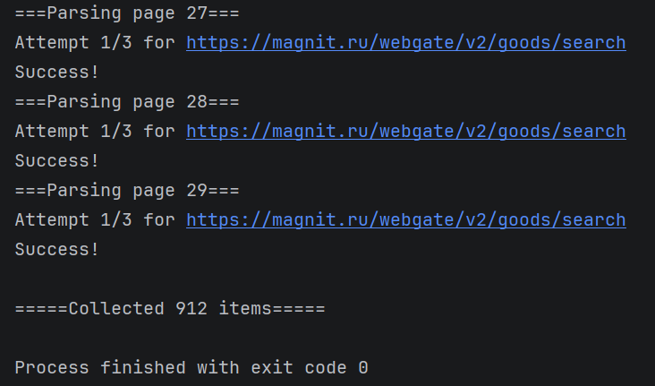
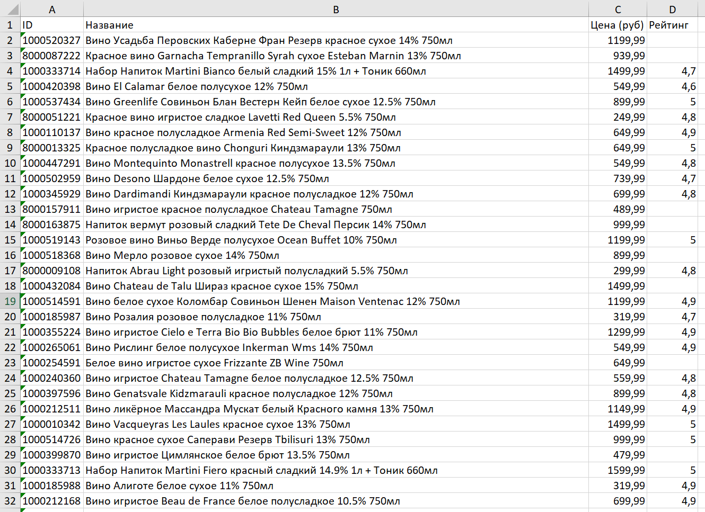

# Парсер каталога KazanExpress (Магнит Маркет)

Скрипт автоматизированного сбора данных о товарах из заданных категорий маркетплейса. 
Данные извлекаются напрямую через внутреннее скрытое JSON API (GraphQL), минуя долгий разбор HTML-верстки.

## Ключевые возможности (Фичи)
* **Перехват скрытого API:** Работа с XHR-запросами и вложенными JSON-ответами.
* **Обход антифрод-защиты:** Динамическая генерация `x-device-id` при каждом запуске для стабильной работы скрипта.
* **Отказоустойчивость:** Встроенная логика повторных попыток (retries) и обработка сетевых ошибок (таймауты, 403, 429, 50x).
* **Пагинация:** Автоматический обход каталога с помощью смещения (`offset`).
* **Безопасное извлечение:** Защита от падений скрипта при отсутствии полей у товара (обработка `None`).
* **Чистый экспорт:** Использование `pandas` для выгрузки спарсенных данных в `.xlsx` таблицу с настроенной автошириной колонок.

## Стек технологий
* `Python 3`
* `httpx` (с поддержкой HTTP/2)
* `pandas`
* `openpyxl`

##Скриншоты работы

**1. Процесс сбора данных (Консоль):**  

**2. Итоговый Excel-отчет:**  
